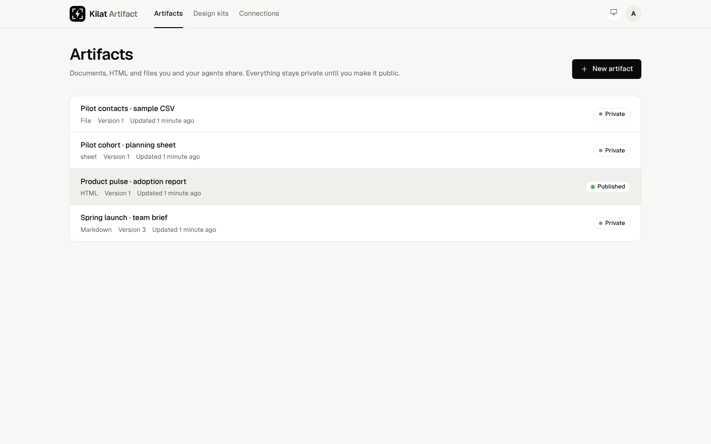
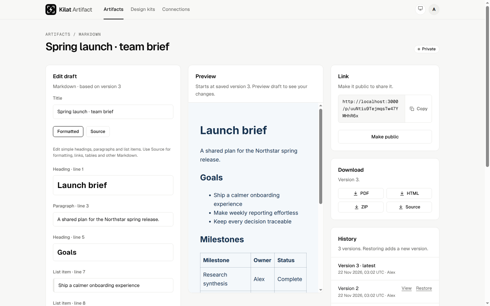
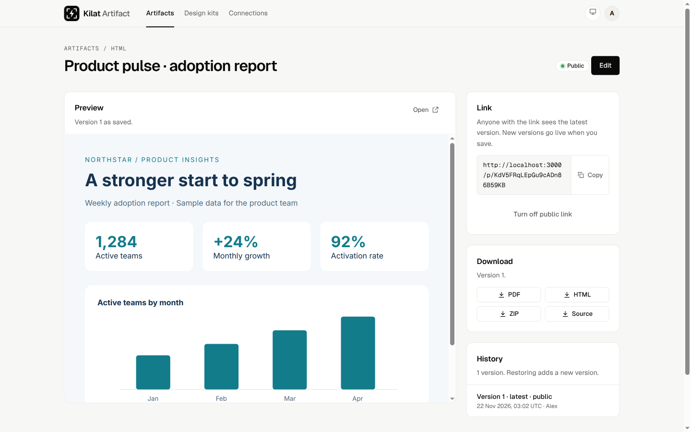
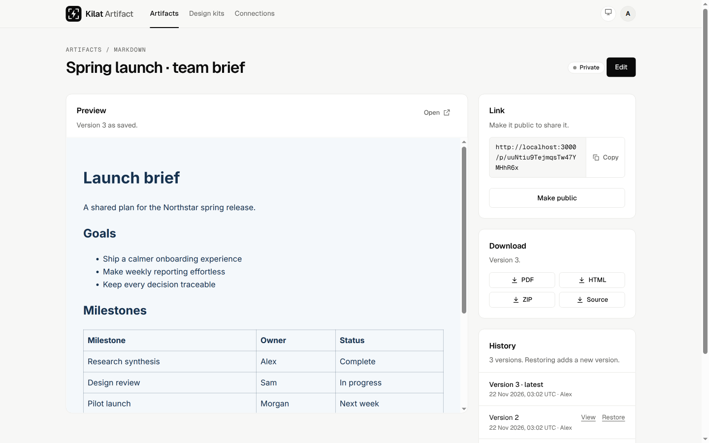
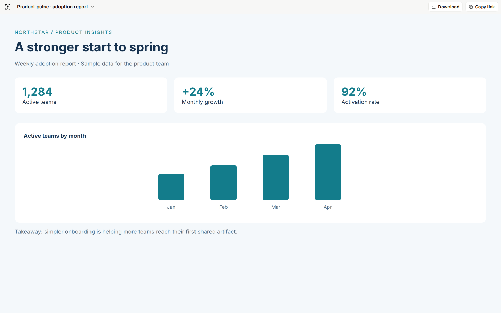

<p align="center">
  <picture>
    <source media="(prefers-color-scheme: dark)" srcset="docs/brand/kilat-artifact-dark.svg">
    
  </picture>
</p>

<h1 align="center">Kilat Artifact</h1>

<p align="center">A shared scratchpad for you and your AI agents.<br>Markdown, HTML pages and files, versioned, with one link that always shows the latest version.</p>

<p align="center">
  <a href="https://github.com/KilatHost/artifact/actions/workflows/ci.yml"></a>
  <a href="LICENSE"></a>
  
  
  
  <a href="deploy.md"></a>
  <a href="#connect-an-agent"></a>
</p>

<p align="center"><a href="#quick-start">Quick start</a> · <a href="#connect-an-agent">Connect an agent</a> · <a href="deploy.md">Deploy</a> · <a href="#security-and-operations">Security</a></p>

**Open source, self-hostable, Apache-2.0.** Create and edit in your browser or through MCP from Claude and other agents. The same application is intended to power Kilat Cloud; a managed service is not available from this repository yet.

> **Status:** early release. CI runs the test suite and a Docker Compose check on Linux (sign-up, publish, PDF, file round trip, restart, backup and restore). The claude.ai connector, MCP Inspector, MCPorter and Claude Code have connected over OAuth ([what each verified](docs/mcp.md#oauth)); Codex CLI, ChatGPT, Gemini and Manus have not been tested. S3 storage is not yet verified.

## Screenshots

Real local app screenshots at 1440 × 900, using fictional sample data. Click a thumbnail for the full image.



| Write and review | Share and connect |
| --- | --- |
| [](docs/screenshots/markdown-editor.png) | [](docs/screenshots/html-report.png) |
| [](docs/screenshots/version-history.png) | [](docs/screenshots/public-page.png) |

[Design kits](docs/screenshots/design-kit.png) · [Connections / MCP](docs/screenshots/connections-mcp.png) · [Dark workspace](docs/screenshots/dashboard-dark.png) · [Dark connections](docs/screenshots/connections-dark.png)

## Contents

- [What it does](#what-it-does) and [limitations](#what-it-does-not-do)
- [Quick start](#quick-start)
- [Publishing](#how-publishing-works)
- [Connect an agent](#connect-an-agent)
- [Design kits](#design-kits)
- [Development](#stack-and-development)
- [Security and operations](#security-and-operations)
- [License](#license)
- [All documentation](docs/README.md)

## What it does

| Capability | Behavior |
| --- | --- |
| Markdown | GitHub-flavoured Markdown, stored as written and rendered on view; raw HTML is dropped |
| HTML | Full pages or fragments, shown as written. Scripts run in a sandbox with no access to the app; libraries load from cdnjs, jsdelivr, unpkg and the Tailwind CDN |
| Rich text | Browser editing with Trix; content stored as sanitized HTML |
| Doc, Sheet, Slides | Structured JSON sources rendered locally in Ruby; edit JSON in the source textarea or create through MCP |
| File artifacts | Upload and version original files, up to 20 MiB each |
| Version history | Saves create immutable versions; restore creates a new version |
| Concurrent edits | Stale version writes fail instead of overwriting newer work |
| Private and public | Private until you make it public; a public link always shows the latest version |
| Delete and restore | Deleting ends public access at once; restore within 7 days, then it is purged with its versions and files |
| Exports | PDF, HTML, source and ZIP; Doc → DOCX, Sheet → XLSX, Slides → PPTX; original attachment downloads for files |
| Shared design kits | Workspace font and color tokens, captured in each saved version |
| Agent connections | MCP over Streamable HTTP, OAuth and revocable personal tokens |
| Workspace boundaries | Each account owns one workspace; private operations are workspace-scoped |

The interface follows the Kilat design system, with a light, dark or system theme switch in the top bar. Geist and Geist Mono ship inside the image, so the app itself loads no third-party fonts or scripts (artifacts may; see Security). Published artifacts use their captured design tokens instead of the interface theme.

The JSON schemas in `config/artifact_types/{doc,sheet,slides}.json` are the portable contract shared with Kilat Web. Typed content is validated and stored as canonical JSON; rendering and Office downloads run locally, without AWS or a rendering service. PDF downloads use Chromium. Office files are generated as OOXML with rubyzip, with no additional runtime dependency. Sheets include one worksheet per tab, column formats and real formulas with cached results; row 1 contains column titles and row 2 is the first data row. Formulas support SUM, AVERAGE, IF, ROUND, MIN, MAX, COUNT, VLOOKUP and arithmetic within a tab. Formula errors display as `#ERROR!` in the viewer and Excel error values in XLSX.

### What it does not do

- No automatic import or synchronization of Claude Artifacts, ChatGPT Canvas, Gemini Canvas or Manus workspaces. Agents must explicitly use this server's tools.
- No built-in AI chat or required model API key. Your AI client supplies the intelligence and pays its own model costs.
- No autosave, real-time co-editing, arbitrary website visual editor or server-side execution of artifact code.
- No live Markdown preview while typing, inline document attachments, team invitations or billing.
- Design kits currently contain fonts and colors, not a full component/template system. Freeform HTML can override those styles; consistent agent output is not guaranteed by tokens alone.
- Generic file artifacts are stored and downloaded, not converted into editable documents. Their link shows a download page; Markdown, HTML and rich-text links render the page.

## Quick start

**Clone → configure two secrets → start → create your first account.** Full production instructions: [Deployment](deploy.md); settings: [Configuration](docs/configuration.md); problems: [Troubleshooting](docs/troubleshooting.md).

Use a Linux host (x86_64 or ARM64) with Git, Docker Engine and Docker Compose v2. No host Ruby or Node installation is required.

```sh
git clone --branch v1.0.0 https://github.com/KilatHost/artifact.git
cd artifact
cp .env.example .env
chmod 600 .env
openssl rand -hex 64
openssl rand -hex 64
```

Put the two independently generated values in `.env` as `SECRET_KEY_BASE` and `POSTGRES_PASSWORD`. Keep the database password hexadecimal because Compose interpolates it into a URL.

```sh
docker compose pull
docker compose up -d --wait
curl --fail http://localhost:3000/up
```

`docker compose pull` downloads the release image `ghcr.io/kilathost/artifact` at the `ARTIFACT_VERSION` in `.env`. To build the image from your checkout instead, run `docker compose up -d --build --wait`. Releases and their changes are listed in [CHANGELOG.md](CHANGELOG.md).

Open <http://localhost:3000> and create an account. There is no default account or seeded password. The port binds to the host's loopback interface, not the public network.

Compose runs three services: `web` (Rails behind Thruster), `jobs` (purges artifacts deleted more than 7 days ago, hourly) and `db` (PostgreSQL). Without Compose, schedule `bin/rails artifacts:purge_archived`.

**Forgotten password.** The self-hosted edition sends no email. An operator runs `docker compose exec web bin/rails users:reset_password EMAIL=person@example.com`, which prints a new random password once and revokes that account's OAuth connections.

For remote access, TLS, storage, backups, restores and upgrades, follow **[deploy.md](deploy.md)**.

## How publishing works

1. Create a private artifact and save versions as you work.
2. Make it public. Its link is `/p/<public_id>`, with a Kilat bar (title, download, copy link) above the artifact.
3. By default every saved version, including a restore, is live at once. With `KILAT_PUBLIC_LINKS=pinned`, publishing pins the current version until an explicit update. Make it private again to turn the link off; the owner can still open it there.

Unpublishing disables the public endpoint, but cannot recall copies already downloaded, cached by third parties or captured in screenshots. Public access is read-only; private version history is not published.

## Connect an agent

Point a compatible Streamable HTTP client at `https://your-host.example/mcp` and authorize with OAuth, or create a revocable personal token in **Connections**. No stdio endpoint is provided. Scopes are independent: `read`, `write`, and opt-in `publish`. Ask the owner before publishing.

See [Connecting agents](docs/mcp.md) for OAuth discovery, tested clients, bearer tokens, the full v1 tool contract, retry/error handling and an editable HTML launch template.

## Design kits

Share workspace font and color tokens with agents. Each saved version captures its kit, so later kit changes do not restyle existing versions. See [Design kits](docs/design-kits.md) for token values and usage.

## Stack and development

Ruby 3.3.13, Rails 8.1 and PostgreSQL with Hotwire/Stimulus; no Node build or Redis required. See [Development](docs/development.md) for the full stack, local setup, tests, lint and Compose smoke checks, [Contributing](CONTRIBUTING.md) for contribution guidance, and [Releasing](RELEASING.md) for release steps.

## Security and operations

Artifact content is untrusted input, not agent instructions. Every response that carries artifact content sends `Content-Security-Policy: sandbox allow-scripts allow-popups …` without `allow-same-origin`, so an artifact runs with an opaque origin: it cannot read this app's cookies, storage or pages, and `connect-src 'none'` blocks fetch and XHR. Set `ARTIFACT_EXTERNAL_RESOURCES=false` to also block the CDN, font and https image hosts (visitors' browsers otherwise contact them when an artifact asks). PDF export runs Chromium without its own sandbox (Docker's default seccomp profile prevents it), with scripts disabled and every request aborted, so a page drawn by scripts (such as a slide deck) prints as its first static state; the PDF download is a static print. HTML artifacts can use forms, dialogs, downloads and the clipboard inside the page, but cannot send data anywhere; opened on its own, an artifact frame redirects to its viewer page. Add network-level egress restrictions for defense in depth.

Public deployments need TLS, trusted proxy configuration, request/upload limits, backups and monitoring. Sign-up is open only for the first account; set `ALLOW_SIGNUP=true` to let anyone create an account (each gets its own workspace). See [deploy.md](deploy.md) for release gates and operational limits.

Report suspected vulnerabilities privately as described in [SECURITY.md](SECURITY.md), not in a public issue; do not publish credentials or a working exploit against customer data.

## License

[Apache License 2.0](LICENSE).

**Trademarks.** The license covers the code, not the Kilat and Kilat Artifact names or the bolt marks (`public/icon.svg`, `public/icon.png`, `app/assets/images/kilat-artifact-mark.svg`). You may run unmodified copies under these names. If you distribute a modified version, use your own name and marks.

Geist and Geist Mono are by Vercel and basement.studio, under the SIL Open Font License 1.1 (`app/assets/fonts/GEIST-OFL.txt`).
