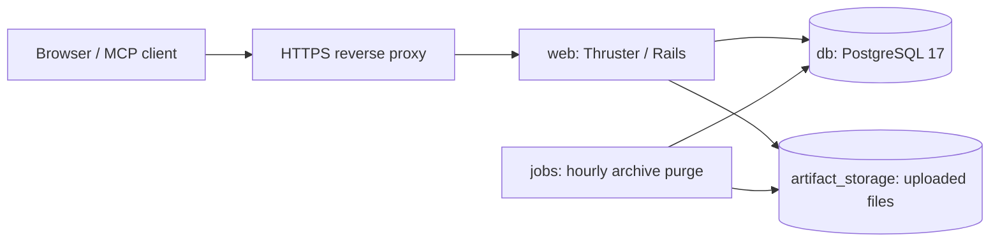

# Deploy Kilat Artifact

This guide covers the current single-host Docker Compose deployment, plus requirements for a managed cloud installation. It does not provision infrastructure or describe a live Kilat Cloud service.

> **Release status:** every change runs a Docker Compose check on Linux in CI (build, sign-up, publish, PDF inside the container, file round trip, refused oversized upload, restart, the backup and restore commands below, purge). The image has also run on ARM64 behind Caddy with Claude connected over OAuth. S3 storage and load have not been tested. Complete the acceptance checklist before using real customer data.

## Quick deploy summary

1. Use a Linux x86_64/ARM64 host with Docker Engine, Compose v2 and persistent disk.
2. [Clone the release and configure](#install) independent signing/database secrets in a protected `.env`.
3. Pull the release image, start Compose and check `/up` using the commands below. Create the first account **before** public exposure.
4. Configure [HTTPS and proxy](#https-and-proxy) for remote access, then verify the [acceptance checklist](#acceptance-checklist).
5. Schedule matched database/file [backups](#back-up) and practice [restore](#restore) before storing important data.

Use the exact commands below. See the [configuration reference](docs/configuration.md) for defaults and forwarding rules, and [troubleshooting](docs/troubleshooting.md) for image authorization, host validation, registration and PDF errors.

## Contents

- [Architecture at a glance](#architecture-at-a-glance)
- [1. Prepare and start](#1-prepare-and-start): [requirements](#requirements), [install](#install), [HTTPS and proxy](#https-and-proxy)
- [2. Storage, recovery and upgrades](#2-storage-recovery-and-upgrades): [local storage](#default-storage), [S3](#s3-compatible-storage), [back up](#back-up), [restore](#restore), [upgrade and rollback](#upgrade-and-rollback)
- [3. Acceptance, monitoring and cloud limits](#3-acceptance-monitoring-and-cloud-limits): [acceptance](#acceptance-checklist), [operations](#operations), [managed cloud readiness](#managed-cloud-readiness), [cost model](#cost-model)

## Architecture at a glance



The proxy is supplied by the operator, not Compose. Only web's port is published, on host loopback. Rails prepares the database on startup; jobs runs the scheduled purge against the same database and storage. PostgreSQL data lives in its own `postgres_data` volume. PDF export launches Chromium inside web; no separate rendering service or Redis is required. S3 is an optional, unverified alternative to local file storage requiring additional runtime configuration.

## 1. Prepare and start

### Requirements

- Linux host with Docker Engine, Docker Compose v2 and Git.
- Persistent disk for PostgreSQL, uploaded files, Docker images and backups.
- A hostname and HTTPS reverse proxy for remote users or hosted AI connectors.
- x86_64 or ARM64 (both are tested).

No host Ruby, Node or PostgreSQL installation is needed. Ruby **3.3.13** and Chromium are installed in the image. Each release publishes a multi-arch image (`linux/amd64`, `linux/arm64`) as `ghcr.io/kilathost/artifact:<version>`; `ARTIFACT_VERSION` in `.env` selects it. `docker compose build` builds the same image from your checkout instead.

There is no measured minimum host size yet. A 2 vCPU / 2 GB ARM instance (AWS t4g.small) with 2 GB of swap built the image and served one user, but was not load-tested. PDF requests launch Chromium synchronously in the web process; size for concurrent renders, not just idle Rails memory.

### Install

```sh
git clone --branch v1.0.0 https://github.com/KilatHost/artifact.git
cd artifact
cp .env.example .env
chmod 600 .env
openssl rand -hex 64
openssl rand -hex 64
```

Edit `.env`, using separate generated values:

| Variable | Required value |
| --- | --- |
| `SECRET_KEY_BASE` | Strong persistent secret for Rails signing/session protection |
| `POSTGRES_PASSWORD` | Independent hex password; Compose inserts it into a database URL |
| `ARTIFACT_VERSION` | Release image to run; matches the checked-out tag. Change it only during an upgrade |
| `APP_HOST` | Hostname only, without scheme, path or port; `localhost` for local access |
| `PORT` | Host loopback port; default `3000` |
| `FORCE_SSL` | `false` for local HTTP; `true` behind correctly configured HTTPS proxy |
| `ALLOW_SIGNUP` | `false` (default): only the first account can sign up. `true` lets anyone create an account with its own workspace |
| `KILAT_PUBLIC_LINKS` | `latest` (default): public links follow new revisions. `pinned` (recommended for cloud): publishing pins the current version until the owner updates the public link or delegates it via MCP publish scope. Existing null-pin links keep following latest. Pass this environment variable into the Rails web container when using Compose. |
| `ARTIFACT_EXTERNAL_RESOURCES` | `true` (default): HTML artifacts may load libraries from cdnjs, jsdelivr, unpkg and the Tailwind CDN, fonts from Google Fonts and images over https, so visitors' browsers contact those hosts. `false` keeps artifacts to inline code and `data:` URIs |

Never commit `.env`, credential keys, database dumps or uploaded files. Preserve `SECRET_KEY_BASE` across upgrades. Changing `POSTGRES_PASSWORD` in `.env` does not change an existing PostgreSQL role's password; rotate both deliberately during maintenance.

```sh
docker compose config --quiet
docker compose pull
docker compose up -d --wait
curl --fail http://localhost:3000/up
docker compose ps
```

To verify the image, compare the digest that `docker buildx imagetools inspect ghcr.io/kilathost/artifact:<version>` reports with the digest on the GitHub release; the release's `SHA256SUMS` covers its source archive and digest file. To run your own build, use `docker compose up -d --build --wait`; it is tagged with the same image name, so pull again before returning to the published image.

Compose starts a private PostgreSQL 17 service, waits for its health check, then starts Rails (`web`) and the `jobs` service that purges deleted artifacts. The web entrypoint runs `db:prepare`, creating or migrating the configured database. Uploaded files and PostgreSQL data use separate named volumes. `--wait` returns once `web` answers its `/up` health check; on a fresh install that includes creating the database.

Open <http://localhost:3000>, then create the first account. There is no seeded administrator or default password. Each account owns one workspace. After the first account, sign-up is closed unless you set `ALLOW_SIGNUP=true`. Create your account before you expose a new instance publicly: the first visitor to sign up becomes an owner.

For a remote host without a public proxy yet, use an SSH tunnel:

```sh
ssh -L 3000:127.0.0.1:3000 your-user@your-server
```

### HTTPS and proxy

The app binds to `127.0.0.1:${PORT}` on the Docker host. A reverse proxy running directly on that host can reach it. A proxy in another container cannot use its own loopback address; deliberately attach it to the app network instead, without publishing the database.

Set:

```dotenv
APP_HOST=artifacts.example.com
FORCE_SSL=true
```

Configure the proxy to:

- Terminate valid public TLS and redirect HTTP to HTTPS.
- Preserve `Host` and set trusted `X-Forwarded-Proto: https`.
- Route `/mcp`, `/oauth/*`, `/.well-known/*`, `/p/*` and normal app paths without rewriting them.
- Never cache authenticated pages, OAuth responses, MCP responses or public artifact pages. A public link follows the latest version, and unpublish depends on endpoints being rechecked.
- Thruster in the image refuses request bodies over 22 MiB (`MAX_REQUEST_BODY`). Set the same or a lower limit at the proxy so oversized uploads stop there.
- Set bounded request timeouts that permit expected PDF renders; apply rate and connection limits.

With [Caddy](https://caddyserver.com) on the same host, one command gets a Let's Encrypt certificate and proxies with the right headers (point the hostname's DNS at the server first, and keep ports 80 and 443 open):

```sh
docker run -d --name caddy --restart unless-stopped --network host -v caddy_data:/data \
  caddy:2 caddy reverse-proxy --from artifacts.example.com --to 127.0.0.1:3000
```

Restart after configuration changes:

```sh
docker compose up -d --force-recreate web
curl --fail https://artifacts.example.com/up
```

`/up` proves Rails responds; it does not independently prove database, storage, OAuth or PDF health. The configured hostname is enforced in production. If requests return a blocked-host error, check `APP_HOST` and forwarded `Host`; do not disable host validation as a shortcut.

Do not expose PostgreSQL, the Rails upstream port or Chromium debugging ports publicly. Keep signup and OAuth endpoints reachable only by intended users when operating a private instance. Proxy-wide browser authentication may break hosted MCP clients; use compatible network access controls and test the complete authorization flow.

## 2. Storage, recovery and upgrades

### Default storage

Compose persists:

| Volume | Content |
| --- | --- |
| `postgres_data` | Accounts, workspaces, versions, design kits, OAuth records and token digests |
| `artifact_storage` | Original uploaded files |

Volume names are prefixed by the Compose project name. Keep that name stable across deployments, or explicitly migrate volumes. Moving the checkout or changing `COMPOSE_PROJECT_NAME` can select empty volumes instead of existing data.

`docker compose down` preserves named volumes. **`docker compose down -v` permanently removes these volumes. Do not use it for upgrades or ordinary shutdown.**

### S3-compatible storage

The app supports `STORAGE_SERVICE=s3` and these runtime variables:

| Variable | Purpose |
| --- | --- |
| `AWS_REGION` | Region; default `us-east-1` |
| `S3_BUCKET` | Private bucket name |
| `S3_ENDPOINT` | Optional alternate S3-compatible endpoint |
| `S3_PATH_STYLE` | Set `true` only if the provider requires path-style addressing |

Use the AWS SDK credential chain, preferably a narrowly scoped workload role. For other providers, inject credentials through a secret manager or protected runtime configuration. Do not put them in the image.

The supplied Compose file does **not** pass these variables to Rails. Add them with a reviewed Compose override or deployment configuration; setting an unreferenced value in `.env` alone does not pass it into a container.

Keep the bucket private, encrypt it, enable suitable retention/versioning and grant only required access. Application authorization remains responsible for private downloads. Existing local files are not automatically migrated when selecting S3. Plan and verify that migration before changing backends.

### Back up

Back up database and blobs as one consistent checkpoint. For the current single-host deployment, stop the `web` and `jobs` services (the purge job also deletes data) while taking both. Commands below write sensitive backup files on the host; protect and encrypt them before copying off-host.

```sh
mkdir -p backups
chmod 700 backups
backup_id=$(date -u +%Y%m%dT%H%M%SZ)
umask 077
docker compose stop web jobs
docker compose exec -T db pg_dump -U kilat -d kilat_artifact_production -Fc > "backups/${backup_id}.dump"
docker compose run --rm --no-deps -T --entrypoint tar web -C /rails/storage -czf - . > "backups/${backup_id}-storage.tar.gz"
{ grep '^ARTIFACT_VERSION=' .env || echo 'ARTIFACT_VERSION= (unset: source install)'; git describe --tags --always; } > "backups/${backup_id}.version"
docker compose start web jobs
```

Run each command only after the preceding one succeeds. If a backup command fails, do not label that checkpoint complete; restart the services after resolving the failure. The `.version` file records the release image and the checked-out revision the checkpoint belongs to. Preserve the deployment configuration and secrets (`.env`, including `SECRET_KEY_BASE`) separately. Encrypt backups, store an off-host copy and verify retention against available disk.

S3 deployments need a matching object checkpoint or a tested version-recovery strategy instead of the local storage archive. A database dump alone is not an artifact backup.

### Restore

Restore first into an isolated environment, never over the only copy of customer data. The commands below restore a checkpoint into a second Compose project with its own empty volumes, on port 3001 of the same host. To restore on another host, copy the checkout, `.env` and backup files there first.

1. Select matching database and storage backups. Check out the revision named in the checkpoint's `.version` file and use the same `.env` (at least the same `SECRET_KEY_BASE` and `ARTIFACT_VERSION`).
2. Choose a project name that has never held data, and keep public access disabled. Start PostgreSQL only, then restore the dump into its empty database and the storage archive into `/rails/storage` (the archive extracts as the image's Rails user, UID/GID `1000:1000`):

   ```sh
   backup_id=20261121T101500Z   # the checkpoint to restore
   export COMPOSE_PROJECT_NAME=artifact-restore PORT=3001
   docker compose up -d --wait db
   docker compose exec -T db pg_restore -U kilat -d kilat_artifact_production --exit-on-error --no-owner --no-privileges < "backups/${backup_id}.dump"
   docker compose run --rm --no-deps -T --entrypoint tar web -C /rails/storage -xzf - < "backups/${backup_id}-storage.tar.gz"
   ```

3. Start the application. The entrypoint migrates a database from an older release; review the changelog before you start a newer image against it.

   ```sh
   docker compose up -d --wait
   curl --fail http://localhost:3001/up
   ```

4. Verify owner login, artifact source and version history, original file bytes, a private download and PDF export. Confirm unrelated users cannot access private artifacts.
5. Record the restore result and recovery time. Only then consider replacing a damaged deployment. To remove the drill, run `docker compose down -v` while `COMPOSE_PROJECT_NAME` is still `artifact-restore`, then `unset COMPOSE_PROJECT_NAME PORT`.

CI runs this backup and restore sequence on every change (`script/smoke.sh`: back up, `down -v`, restore into fresh volumes, check a public page and file bytes). Run the full procedure with your own backups before relying on it, and record your recovery time.

### Upgrade and rollback

Read the [changelog](CHANGELOG.md) entries between your version and the target. The entrypoint runs database migrations when `web` starts.

1. Record the running release and image, then take a checkpoint as in [Back up](#back-up):

   ```sh
   grep '^ARTIFACT_VERSION=' .env
   docker compose images web
   ```

2. Check out the target release, select its image and start it:

   ```sh
   version=1.0.0   # the target release
   git fetch --tags
   git checkout "v${version}"
   sed -i "s/^ARTIFACT_VERSION=.*/ARTIFACT_VERSION=${version}/" .env
   grep -o '^[A-Z_]*=' .env.example | grep -vxFf <(grep -o '^[A-Z_]*=' .env)   # settings new in this release, if any
   docker compose pull
   docker compose up -d --wait
   curl --fail http://localhost:3000/up
   ```

3. Verify health plus a real create, edit, export and MCP flow before ending maintenance.

**From a source install before 1.0.0** (cloned from `main` and started with `docker compose up --build`): `.env` has no `ARTIFACT_VERSION` line, so run `echo "ARTIFACT_VERSION=${version}" >> .env` instead of the `sed` line. Keep the same checkout directory, or set the same `COMPOSE_PROJECT_NAME`, so Compose keeps using the existing volumes. The previous locally built images stay on the host for rollback.

**Rollback.** A code rollback is safe only when the previous release supports the current schema; the changelog says when a release's migrations are not backward compatible. Then check out the previous tag, set its `ARTIFACT_VERSION` and run `docker compose up -d --wait`. Otherwise restore the matching pre-upgrade checkpoint during maintenance. That loses writes made after the checkpoint; obtain explicit approval before taking that path. Do not blindly run migrations down or restore over current data.

## 3. Acceptance, monitoring and cloud limits

### Acceptance checklist

Before using real customer data:

- [ ] Linux image builds with Ruby 3.3.13; migrations and normal startup succeed.
- [ ] HTTPS works without redirect loops; cookies and host checks behave correctly.
- [ ] Two accounts cannot read or modify each other's artifacts, versions, files, kits or connections.
- [ ] Markdown/HTML/rich-text/file create and edit work; stale browser edits are rejected.
- [ ] A public link shows each new version at once; unpublish removes access for everyone but the owner.
- [ ] An HTML artifact's scripts run, while `document.cookie` and `fetch('/artifacts')` inside it fail, and opening `/p/<id>/frame` directly lands on `/p/<id>`.
- [ ] Original file downloads match uploaded bytes after a container restart.
- [ ] PDF renders inside the container with no artifact-controlled network access.
- [ ] HTML/ZIP/source downloads contain the selected saved version.
- [ ] OAuth registration, browser consent, PKCE, refresh and revocation work through the actual proxy.
- [ ] Read/write/publish permissions remain distinct in a real MCP client.
- [ ] Your AI clients connect and revise an artifact (Claude on claude.ai is tested; others are not yet).
- [ ] Backup restoration passes in an isolated deployment.

### Operations

```sh
docker compose ps
docker compose logs --tail=100 web
docker compose logs --tail=100 db
docker compose logs --tail=100 jobs
```

The `jobs` service purges artifacts deleted more than 7 days ago. If it stops, deleted artifacts stay in Deleted and keep using storage until it runs again.

Logs can still contain operational metadata. Do not share raw logs before checking for secrets or private user content. Configure host/container log rotation; default unbounded Docker logs can exhaust disk.

Monitor app errors and latency, database connections/storage, upload volume, backup age and restore results, Chromium crashes/render duration, memory pressure and outbound traffic. Alert on disk exhaustion before PostgreSQL or uploads fail.

PDF export runs synchronously, one render per web process; a second request gets a 503 asking to try again. It is not queued, quota-controlled or cached. Set external request limits before broad public access. Chromium runs with `--no-sandbox` because Docker's default seccomp profile stops its sandbox; scripts are disabled and all requests aborted during the render, and the container runs as a non-root user.

### Managed cloud readiness

The same app can use managed PostgreSQL and private S3-compatible storage, but this is not a finished hosted platform. Before a cloud launch, provide:

- TLS, secret delivery, managed database recovery, object retention, monitoring and a tested incident/recovery procedure.
- A configured shared rate-limit cache before running multiple Rails processes/replicas. The repository does not configure that cache.
- Measured PDF concurrency limits and customer storage/transfer limits. No built-in billing, storage quota enforcement or metered cloud plans exist yet.

Keep database and object storage private. Test tenant isolation after changes to proxying, storage or authentication. Do not label named AI clients compatible until each has passed its real connection flow.

### Cost model

No mandatory model API cost is incurred by this service. Hosting cost is:

```text
compute + PostgreSQL + stored artifact versions + original files
+ backups + download transfer + object requests + monitoring
```

PDF rendering adds CPU/memory demand; immutable versions increase retained storage. Measure render seconds, peak concurrency, retained bytes and downloads before choosing an instance or price. No hosting quote, capacity promise or production cost benchmark is available yet.
