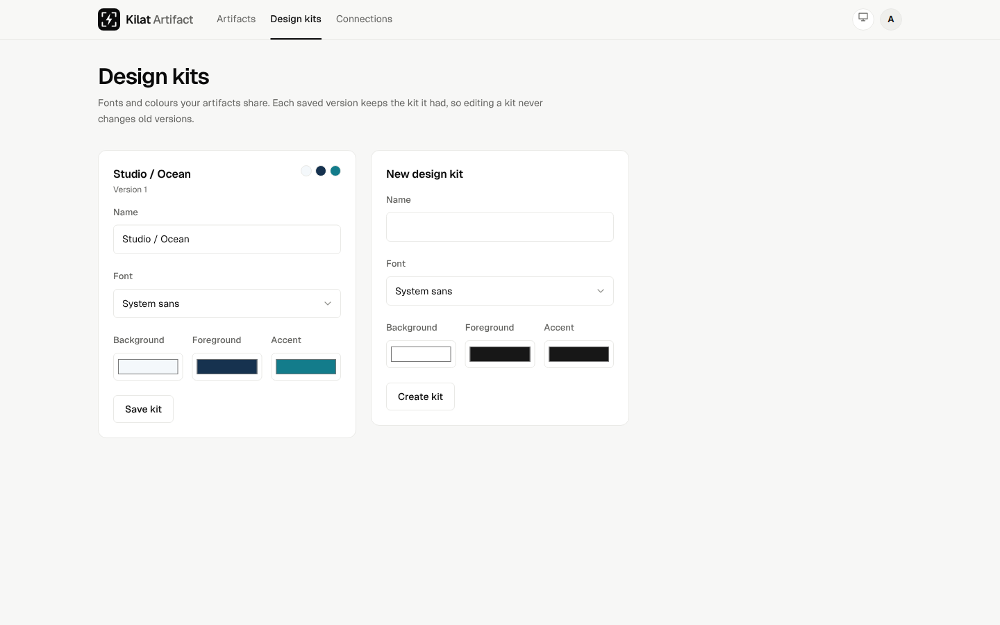

# Design kits

Agents should list available kits, choose one and supply its ID when creating an artifact. A kit uses this token shape:

```json
{
  "font": "system-ui",
  "background": "#ffffff",
  "foreground": "#171717",
  "accent": "#171717"
}
```

Fonts are `system-ui`, `serif` or `monospace`; colors must be six-digit hex values. Existing versions retain their captured kit values when a kit changes. A restored version retains its original styling snapshot.


Open **Design kits** to create or edit a kit, then select it when creating a draft. Agents use `list_design_kits`, `create_design_kit` and `update_design_kit`; see the [MCP contract](mcp.md#v1-mcp-contract).



[Documentation index](README.md)
